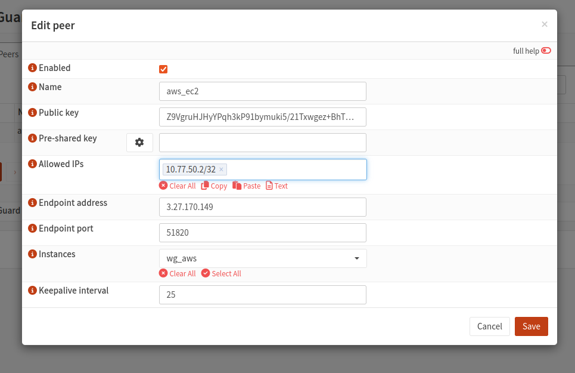
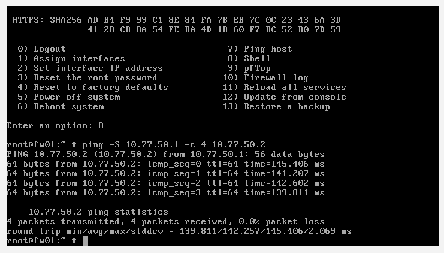
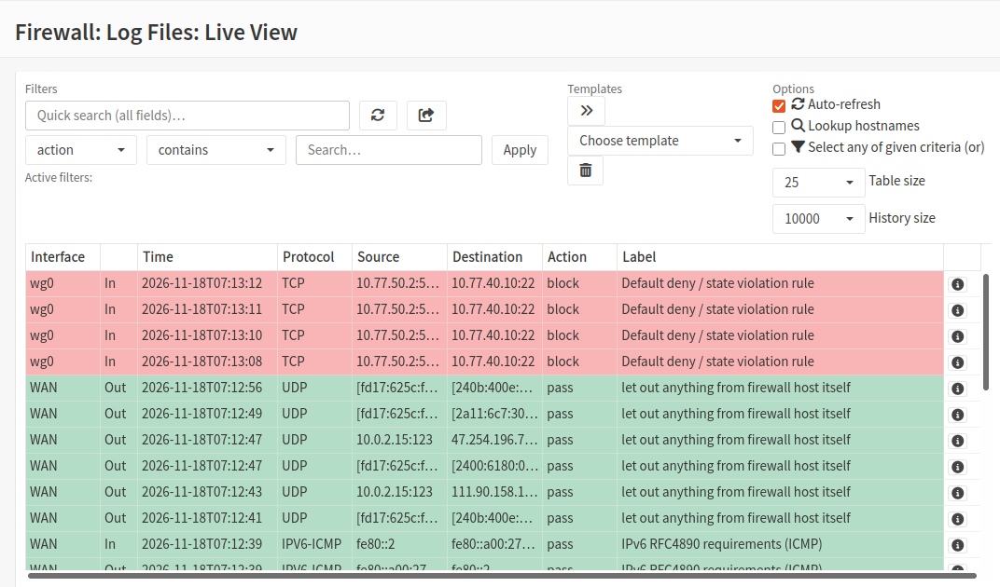
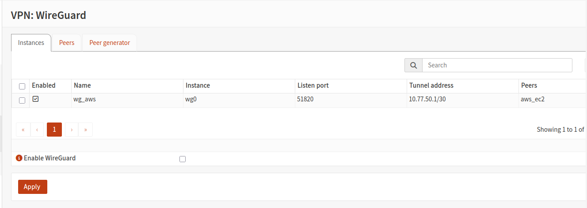

# AWS hybrid connectivity with WireGuard

Status: initial IPv4 hybrid-access milestone verified. Recorded on 18 November 2026 (Asia/Kuala_Lumpur). This extends the [real VM lab](real-vm-lab.md); the Packet Tracer implementation remains separate.

## Outcome and scope

An Ubuntu EC2 host connects to the local OPNsense firewall over WireGuard. EC2 can reach WEB01's Nginx service on TCP 80; an attempted TCP 22 connection is blocked at OPNsense. A successful handshake, tunnel ping, route lookup, HTTP response, and firewall log support this result.

This is a single EC2 host accessing one local server, not proof of connectivity from an entire AWS VPC or complete network isolation. IPv6 policy, recovery, monitoring, automation, and cost verification remain open.

## Topology

```text
EC2 (ens5: 10.88.10.171; wg0: 10.77.50.2/30)
    |
    | WireGuard UDP 51820 over the Internet
    | OPNsense initiates through home NAT and VirtualBox NAT
    |
OPNsense (wg0: 10.77.50.1/30)
    | SERVERS: 10.77.40.1/24
    |
WEB01 (10.77.40.10/24; gateway 10.77.40.1)
    TCP 80 allowed from 10.77.50.2
    TCP 22 attempt blocked from 10.77.50.2
```

| Component | Recorded setting | Evidence |
| --- | --- | --- |
| AWS region | Sydney, ap-southeast-2 | User-reported |
| VPC | hybrid-lab-vpc | Prior-session screenshot confirmed Available |
| Managed NAT gateways | None | User-confirmed |
| EC2 public IPv4 at testing | 3.27.170.149 | Successful SSH and user confirmation |
| EC2 private IPv4 | 10.88.10.171 on ens5 | Login and pasted route output |
| EC2 OS | Ubuntu 26.04.1 LTS | Login output recorded in prior-session summary; planned 24.04 was not the installed release |
| Security group | hybrid-lab-vpn-sg | Prior-session evidence; full final rules export not captured |
| OPNsense | 26.7-amd64 | User-reported |
| WireGuard tools on EC2 | v1.0.20250521 | Pasted version output |
| EC2 UFW | Inactive at setup | Pasted status output |

VPC/subnet CIDRs, route tables, instance type, disk allocation, CPU credit mode, and hourly charges have not been verified. The private address alone does not establish the subnet prefix.

## Configuration recorded

### EC2 SSH and security group

Windows PowerShell used an SSH key stored outside the repository:

```powershell
ssh -4 -o ConnectTimeout=10 -o IdentitiesOnly=yes -i "$env:USERPROFILE\Downloads\hybrid-lab-aws.pem" ubuntu@3.27.170.149
```

The instructed inbound policy was TCP 22 and UDP 51820 from the current home public IPv4 /32. The user confirmed changing the SSH source when switching from a mobile hotspot to home Wi-Fi. EC2's public address stayed unchanged. The later handshake confirms the WireGuard transport path worked, but is not a substitute for an audit of every attached security-group rule.

### EC2 WireGuard

Keys were generated under /etc/wireguard using a restrictive umask. The following is a sanitized reconstruction of the final configuration, not an exported live file:

```ini
[Interface]
Address = 10.77.50.2/30
ListenPort = 51820
PrivateKey = <EC2_PRIVATE_KEY_NOT_PUBLISHED>

[Peer]
PublicKey = <OPNSENSE_PUBLIC_KEY>
AllowedIPs = 10.77.50.1/32, 10.77.40.10/32
```

EC2 learns the peer endpoint from OPNsense's authenticated traffic. No fixed home endpoint was placed in this configuration. The service was enabled with:

```bash
sudo systemctl enable --now wg-quick@wg0
```

Service startup and later restart were demonstrated; persistence after an EC2 reboot has not been tested.

### OPNsense WireGuard

| Setting | Value |
| --- | --- |
| Global Enable WireGuard | Enabled after troubleshooting |
| Instance name / device | wg_aws / wg0 |
| Instance enabled | Yes |
| Tunnel address | 10.77.50.1/30 |
| Listen port | 51820 |
| Selected peer | aws_ec2 |
| Peer public key | EC2 public key |
| Peer allowed IPs | 10.77.50.2/32 |
| Peer endpoint | 3.27.170.149:51820 |
| Keepalive interval | 25 seconds |
| Pre-shared key | Empty |



The screenshot records peer settings, not a successful handshake. Public keys are not private credentials. No private keys or full firewall backup are included.

### OPNsense HTTP permission

The instructed rule on WireGuard (Group) was:

| Field | Value |
| --- | --- |
| Action / IP version / protocol | Pass / IPv4 / TCP |
| Source / source port | 10.77.50.2/32 / any |
| Destination / destination port | 10.77.40.10/32 / 80 |
| Logging | Enabled |
| Description | Allow EC2 tunnel to WEB01 HTTP |

The subsequent HTTP response and SSH block demonstrate the tested access behavior. A screenshot/export of the final HTTP rule was not supplied. No broad LAN or VPC ranges were added to the EC2 peer's AllowedIPs.

## Validation evidence

Screenshots below are original user-supplied captures. Terminal excerpts are transcribed from user-pasted output, with public keys and the home public endpoint omitted where unnecessary. These were interactive lab tests, not automated tests executed by a repository CI system.

| Test | Result | Evidence type |
| --- | --- | --- |
| WireGuard handshake | Fresh handshake and received/sent counters | Pasted EC2 output |
| OPNsense 10.77.50.1 to EC2 10.77.50.2 | Four replies, zero loss | Screenshot |
| EC2 route to WEB01 | wg0, source 10.77.50.2 | Pasted EC2 output |
| EC2 to WEB01 TCP 80 | HTTP/1.1 200 OK | Pasted EC2 output |
| EC2 to WEB01 TCP 22 | Blocked inbound on wg0 | Screenshot and user confirmation |

### Handshake and route

EC2 SSH session, after fixing the configuration syntax:

```text
$ ip route get 10.77.40.10
10.77.40.10 dev wg0 src 10.77.50.2 uid 1000
    cache

$ sudo wg show
interface: wg0
  [key lines omitted]
  listening port: 51820

peer: [public key omitted]
  endpoint: [home public endpoint omitted]
  allowed ips: 10.77.50.1/32, 10.77.40.10/32
  latest handshake: 8 seconds ago
  transfer: 180 B received, 92 B sent
```

### Tunnel ping

OPNsense console, option 8 (Shell):

```sh
ping -S 10.77.50.1 -c 4 10.77.50.2
```

The screenshot records four packets transmitted, four received, 0.0% loss, and round-trip min/avg/max/stddev of 139.811/142.257/145.406/2.069 ms.



This tests traffic initiated by OPNsense and returning through the tunnel; it does not prove unrestricted inbound ICMP to OPNsense.

### HTTP to WEB01

EC2 SSH session:

```bash
curl --connect-timeout 5 --max-time 10 -I http://10.77.40.10
```

User-pasted response:

```http
HTTP/1.1 200 OK
Server: nginx/1.24.0 (Ubuntu)
Date: Tue, 17 Nov 2026 23:10:24 GMT
Content-Type: text/html
Content-Length: 615
Last-Modified: Wed, 14 Oct 2026 02:55:53 GMT
Connection: keep-alive
ETag: "6aceef39-267"
Accept-Ranges: bytes
```

The HTTP date corresponds to 18 November 2026, 07:10:24 in Malaysia. This was a HEAD request confirming HTTP response headers, not a downloaded-page integrity test.

### Denied SSH to WEB01

The requested EC2 test was:

```bash
nc -vz -w 5 10.77.40.10 22
```

The user confirmed the block and supplied the following firewall log. The terminal result itself was not pasted, so an exact netcat error or timeout duration is not claimed.



The red entries show inbound TCP on wg0 from 10.77.50.2 to 10.77.40.10:22, action block, label "Default deny / state violation rule". Source-port text is truncated by the UI. This verifies this specific IPv4 SSH denial, not a block on all IPv4 traffic. Unrelated WAN IPv6 entries in the same screenshot are outside this test's scope.

## Troubleshooting

### Windows SSH access

Prior-session records describe an IPv6 SSH source rule while the client used IPv4, followed by a correction to an IPv4 /32 rule. Windows then rejected the PEM because CodexSandboxUsers had access; restricting the file ACL to the current Windows user was followed by successful login. The PEM and its contents are excluded from GitHub.

Later, SSH timed out after the user changed from hotspot to Wi-Fi. Updating the security-group source to the new home IPv4 restored access; EC2 remained at 3.27.170.149. A trailing backslash in a pasted PowerShell command was also removed, but that character alone was not established as the timeout's root cause.

### Instance enabled, global service disabled

The instance and peer were configured, but EC2 showed no handshake or endpoint. This pre-fix screenshot shows the instance enabled while the global Enable WireGuard box is unchecked:



Checking the global box and applying was followed by a handshake 33 seconds old, with 212 B received and 92 B sent. The later ping validated tunnel IP traffic.

### Configuration parse failure after adding WEB01

The EC2 restart failed with:

```text
Line unrecognized: `i[Interface]'
Configuration parsing error
```

The AllowedIPs line was correct; an accidental leading i had changed the section header. While startup was failed, the route lookup showed:

```text
10.77.40.10 via 10.88.10.1 dev ens5 src 10.88.10.171 uid 1000
```

Removing the extra i restored [Interface]. Restarting wg-quick@wg0 then produced the wg0 route and fresh handshake shown above. A route lookup must be checked for its selected interface and source; merely returning a route is not proof that VPN routing works.

## Remaining work and operational limits

- Audit actual AWS instance, storage, credit mode, VPC/subnet routing, and attached security-group settings. Record cost and credit consumption. The user reports USD 100 credit expiring 12 May 2027 and a cash budget of RM0; credit coverage and current balance were not independently verified. No assertion of zero running cost is made.
- Update both relevant security-group source rules when the home public IP changes. If EC2's public IP changes, update the OPNsense endpoint and SSH destination.
- Test tunnel recovery after reboots and connection changes; service enablement alone is not recovery evidence.
- Review IPv6 policy and broad existing management/LAN permissions. These IPv4 tests do not close those items.
- Test encrypted backups and isolated restoration. Existing backup-copy checksum verification is not a restore test.
- Add monitoring and automation with separate evidence.
- Access from other AWS hosts or wider networks requires a separate routing and policy design; it was not configured or tested here.

## References

- [WireGuard quick start](https://www.wireguard.com/quickstart/)
- [OPNsense WireGuard site-to-site guide](https://docs.opnsense.org/manual/how-tos/wireguard-s2s.html)
- [AWS EC2 security groups](https://docs.aws.amazon.com/AWSEC2/latest/UserGuide/ec2-security-groups.html)

These references explain the configuration approach; the screenshots and pasted outputs above establish the lab results.
