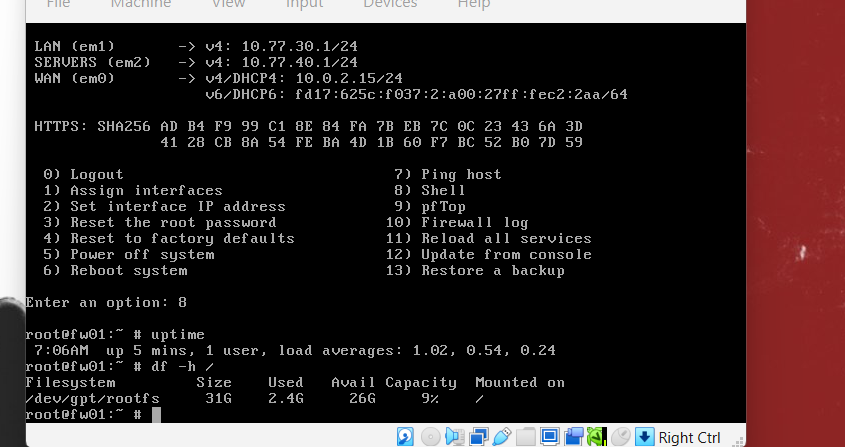

# HTTP monitoring and firewall recovery validation

Recorded: 19 November 2026, Asia/Kuala_Lumpur. This builds on the [AWS WireGuard lab](aws-wireguard-lab.md).

## Verified outcome

An EC2 systemd timer runs a shell script against WEB01 over the hybrid path. During a controlled Nginx outage, scheduled checks recorded three failures, then two successful HTTP 200 responses after manual restoration. This implements basic scheduled availability monitoring; it does not implement notifications, automatic remediation, or full infrastructure provisioning.

The separate OPNsense recovery exercise restored tunnel traffic, HTTP access, and the tested SSH denial after a forced power-off and subsequent console boot/reboot. It was not a clean web-interface reboot test.

## Monitoring files

- [Health-check script](../scripts/check-web01.sh)
- [Service unit](../configs/systemd/web01-health.service)
- [Timer unit](../configs/systemd/web01-health.timer)
- [User-supplied journal transcript](../labs/evidence/web01-health-outage-journal.txt)

These source files reproduce the commands used during the guided setup, including the corrected DynamicUser setting. They are not fetched exports from EC2. The supplied terminal results verify the deployed behavior.

The script performs an HTTP GET, discards the body, and requires status 200. It allows five seconds to connect and ten seconds overall. It logs a UTC timestamp and exits 0 for success or 1 for connection failure/unexpected HTTP status. It does not follow redirects, inspect page content, or identify which component caused a failure.

### Installation on EC2

From the root of a checkout of this repository in the EC2 SSH session, with bash and curl available:

```bash
sudo install -o root -g root -m 755 scripts/check-web01.sh /usr/local/bin/check-web01
sudo install -o root -g root -m 644 configs/systemd/web01-health.service /etc/systemd/system/web01-health.service
sudo install -o root -g root -m 644 configs/systemd/web01-health.timer /etc/systemd/system/web01-health.timer
sudo systemctl daemon-reload
sudo systemctl enable --now web01-health.timer
sudo systemctl start web01-health.service
systemctl list-timers web01-health.timer --no-pager
sudo journalctl -u web01-health.service -n 15 --no-pager
```

Review any existing destination files before replacing them. No private keys are required by the monitor. Its route and firewall prerequisites are documented in the AWS lab report.

The timer has OnBootSec=60s, OnUnitActiveSec=60s, and AccuracySec=1s. The observed checks were approximately 61 seconds apart. Scheduling is not an exact wall-clock guarantee. The oneshot service normally becomes inactive after success while its timer remains active. Failure exit status is intentional when the target is unavailable; later timer runs continue.

An initial User=nobody setting generated the systemd warning "Special user nobody configured, this is not safe!" It was replaced with DynamicUser=yes. Subsequent user-pasted output confirmed:

```text
Result=success
ExecMainStatus=0
DynamicUser=yes
```

The corrected service retains NoNewPrivileges, PrivateTmp, ProtectSystem=strict, and ProtectHome. DynamicUser supplies a transient service identity rather than the shared nobody account.

## Controlled outage and recovery

Procedure supplied to the user:

1. WEB01 SSH from ADMIN01 or WEB01 console: run sudo systemctl stop nginx.
2. Wait approximately 75 seconds; inspect the EC2 journal without manually triggering the health service.
3. WEB01 SSH/console: restore with sudo systemctl start nginx, then check systemctl is-active nginx.
4. Wait approximately 75 seconds; inspect the EC2 journal again.

The returned [journal transcript](../labs/evidence/web01-health-outage-journal.txt) includes overlapping three-minute and five-minute queries. Duplicate lines across those windows do not represent extra checks. The WEB01 service-status output was not included; HTTP recovery is directly shown by the EC2 journal.

| UTC, 18 November 2026 | Malaysia, 19 November 2026 | Observed result |
| --- | --- | --- |
| 23:20:50 | 07:20:50 | OK, HTTP 200 |
| 23:21:51 | 07:21:51 | Connection failed; exit 1 |
| 23:22:52 | 07:22:52 | Connection failed; exit 1 |
| 23:23:53 | 07:23:53 | Connection failed; exit 1 |
| 23:24:54 | 07:24:54 | OK, HTTP 200 |
| 23:25:55 | 07:25:55 | OK, HTTP 200 |

The failed requests report curl error 7. The cadence and supplied test sequence support scheduled detection across the outage and recovery. Nginx was manually restored; systemd did not repair it. Exact stop/start timestamps were not captured, so actual outage duration and detection latency are not measured.

## OPNsense recovery exercise

The user reported that a web-interface reboot took a long time, powered off the VM, and subsequently booted/rebooted OPNsense through its VM console. The cause of the slow shutdown remains unknown; this sequence must not be recorded as a successful graceful reboot.

After the firewall returned, the EC2 output showed:

```text
latest handshake: 21 seconds ago
transfer: 5.25 KiB received, 3.38 KiB sent
```

The user-pasted HTTP response included:

```http
HTTP/1.1 200 OK
Server: nginx/1.24.0 (Ubuntu)
Date: Wed, 18 Nov 2026 23:02:58 GMT
Content-Type: text/html
Content-Length: 615
```

The date is 19 November 2026, 07:02:58 in Malaysia. The user subsequently confirmed that a repeated EC2-to-WEB01 TCP 22 attempt was blocked in OPNsense. That post-restart denial is user-confirmed, without a new screenshot or terminal transcript.



The screenshot shows five minutes of uptime and /dev/gpt/rootfs mounted at / with 31G size, 2.4G used, 26G available, and 9% capacity. These are filesystem measurements, not proof of the full virtual disk allocation or filesystem integrity. The user also confirmed the dashboard worked normally. Recovery duration was not measured.

## Operation and limits

Inspect recent checks in the EC2 SSH session:

```bash
sudo journalctl -u web01-health.service --since "10 minutes ago" --no-pager
systemctl show web01-health.service -p DynamicUser -p Result -p ExecMainStatus
systemctl list-timers web01-health.timer --no-pager
```

To disable scheduling on EC2:

```bash
sudo systemctl disable --now web01-health.timer
```

- The monitor runs on the same EC2 host as the WireGuard endpoint. An EC2 outage prevents monitoring and is not detected externally.
- A failure can involve Nginx, WEB01, firewall rules, routing, or the tunnel. The script does not independently validate WireGuard handshakes.
- No external alerts are configured; logs are local. Journal persistence/retention across reboots has not been verified.
- EC2 reboot persistence of both WireGuard and the timer remains untested.
- Isolated backup restoration and encryption verification remain pending. A restart recovery test is not a backup restore.
- IPv6 policy, broader firewall review, and full infrastructure automation remain open.
